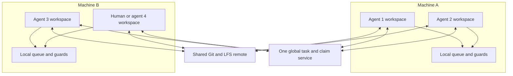

# Yorimichi V2: the game and the way we build it

**Status: execution plan, not an implementation report.** Written 6 November 2026.
No milestone below is complete merely because this file exists.

**Goal:** rebuild the original Yorimichi in Unreal, with its world, characters and
gameplay, while letting people and agents work independently without repeatedly
preparing and importing the whole game.

**Explicit exclusions for this version:** phone streaming and driving. Here,
driving means the go-kart feature and its `Driving` plugin integration. Bikes,
horses, sailboats, trains, ferries, gondolas and the zeppelin remain in scope.
There is no browser game, mobile build or new gameplay requirement.

The main change is simple: **keep the finished, editable Unreal assets in Git
LFS. Change and import only the assets a task actually changes.** Give each worker
their own checkout, divide ownership into small parts, and use one shared claim
service to prevent conflicting binary edits across all machines.

## 1. Read this before doing any work

1. Start at **P0**, in section 12. Do not start the full port before the small
   experiment passes **P3**.
2. Use `games/yorimichi_v2/` for the new game. Keep the original game available as
   a reference until V2 passes acceptance. Do not turn its working checkout into
   V2 in place.
3. Pin the exact existing Unreal 5.8 build, including local engine patches.
   Do not upgrade Unreal during this migration.
4. Commit editable Unreal content, required source assets and import records.
   An ordinary checkout must not need Blender, an AI provider, a donor checkout
   or a private asset cache to open the game.
5. A normal build may compile code and prepare Unreal's temporary caches. It
   must not generate meshes, reimport assets, rebuild the world or cook a release.
6. Each agent and human uses an independent checkout. No shared writable
   `Content`, `Binaries`, `Intermediate` or `Saved` directory.
7. Claim a binary asset or world area before changing it. A Git branch alone
   does not prevent two people from overwriting the same Unreal asset. Until
   the claim service exists, use the single-writer bootstrap rule in section 9.
8. A claim lasts through review and merge. Another agent using the same GitHub
   account is still another owner.
9. Keep the current machine's admission and memory protections. More agents
   do not make the machine capable of running unlimited Unreal processes.
10. A task is complete only when its intended change is merged and its checks
    refer to that change. A screenshot, successful compile or empty error log
    alone does not establish completion.

### Old documents and code contracts are optional inputs

**The owner explicitly authorizes ignoring or deleting any pre-existing
documentation or code contract that does not directly contribute to V2.**
Do not preserve an old rule merely because it is called a contract, appears in
`AGENTS.md`, or was important to a previous experiment. Do not implement obsolete
requirements to make an old checklist green. No additional approval is needed
just to retire an irrelevant document or contract.

For V2, the owner's current instructions and this plan replace incompatible
historical design rules. In particular:

- Ignore the old requirement that all Unreal content be an ignored build output.
- Ignore requirements to recreate the world from scripts on every fresh checkout.
- Ignore browser, phone streaming and driving requirements for this version.
- Ignore old infrastructure roadmaps unless a specific V2 need justifies them.
- Keep useful knowledge: asset identities, character rigs, gameplay behavior,
  ground and collision checks, licenses, and working performance measurements.
- Keep protections that directly make V2 work safe and reliable: credentials
  stay private, paid requests are accounted for, each machine admits heavy jobs,
  and workers cannot damage each other's files or processes.

During P0, make a short **keep / replace / retire** list. For every retained rule,
name the V2 behavior it protects. Delete a redundant file, or mark a useful
historical file as reference-only; Git already preserves its history. Update
links, inherited `CONTRACTS` scope and automated checks in the same change so
retired rules do not continue to constrain V2 accidentally. Do not remove an
active shared tool's protection or break another retained game as a side effect.
Scope a rule away from V2 when another game still needs it.

This is permission to simplify, not a new documentation project. Keep a short V2
README, this plan, an inventory and evidence for completed work. Add a local
README or contract only when it explains a real boundary or prevents a known
failure. There is no requirement to add boilerplate to every folder.

### What “original Yorimichi” means

The starting source is commit
`7eec0f98dd02c9505d3870336717b3edf830be73`. The published reference playtest is
`yorimichi-macos-2026-10-23-r13`. They are **two references, not a claim that the
release was built from that commit**. P0 must reconcile the release manifest,
source, available editable content and any later approved work.

Preserve working, in-scope behavior. A proposal in an old document is not a
feature that must now be invented. A known unfinished feature is not silently
accepted as working either: record it and settle it before the final acceptance
that depends on it. Local uncommitted experiments are not automatically part of
the baseline; inventory and preserve them without overwriting their owner.

The repository also contains a build system called `build-v2` and older regional
experiments called `v2`. Those names do not mean they implement this plan.

## 2. Why this should fix the repeated work

There are five different operations. Do not combine them into one automatic
“build everything” command.

| Operation | What it does | When it runs in V2 |
| --- | --- | --- |
| Prepare | Blender exports, texture baking, mesh reduction, animation preparation | Explicitly, for changed source assets |
| Import | Turns an external file into an editable Unreal asset | Explicitly, for that asset and real dependents |
| Compile | Turns C++ into editor or game code | When relevant code changes |
| Cache | Builds temporary shader, texture or mesh data Unreal needs | On demand; reuse compatible results |
| Cook and package | Makes a standalone game for a target platform | Integration milestones and releases |

The original project already separates packaging from normal builds. Its larger
problem is that editable Unreal content is not committed, and several scripts
own broad outputs. The current world also creates much of its static scenery
from `world.json` at runtime. Adding Git LFS without changing those ownership
boundaries would preserve much of the old problem.

The desired loops are:

| Change | Required work | Work that should not happen |
| --- | --- | --- |
| Move a bench | Save its actor file and any genuine companion files; preview | Mesh export, texture import, whole-map replacement |
| Change a bench mesh | Export/import that mesh; refresh affected collision or bounds | Reimport trees, characters or unrelated regions |
| Change skating C++ | Compile affected code; run skating checks | Blender, asset imports, world generation |
| Change a master material | Save the material; compile its affected shaders | Pretending a large shader rebuild can always be avoided |
| Change a skeleton | Update its declared dependent meshes/animations; test them | Importing only the skeleton and ignoring broken animation |
| Pull a finished feature | Download changed LFS objects, compile if needed, open | Rebuilding its authoring pipeline |
| Produce a release | Validate sources/content, compile, cook, package, verify | Recreating unchanged authoring assets first |

A first checkout still downloads large files and may compile C++ and shaders.
An engine upgrade can invalidate caches. Cooking can touch more than the edited
actor: One File Per Actor separates editor files, not cooked release files.
These costs must be measured separately from avoidable repeated imports.
See [Epic's One File Per Actor documentation](https://dev.epicgames.com/documentation/en-us/unreal-engine/one-file-per-actor-in-unreal-engine).

## 3. Fixed design choices

| Question | Decision for the experiment | Reason and cost |
| --- | --- | --- |
| Engine | Exact proven Unreal 5.8 installation | Keeps migration problems separate from engine changes |
| Project | One new Unreal project in the existing repository | Shares working platform code and makes integration visible |
| Source control | Git for text; Git LFS for Unreal packages and large binary sources | Familiar branches; binary files still need exclusive ownership |
| World | World Partition and One File Per Actor for the island | Separate saved actors and loading regions; requires dependency and streaming checks |
| Content creation | Targeted scripts plus ordinary editor authoring | Both work; each property/package has one source of truth |
| Gameplay | Existing C++ behavior, divided by feature | Reuse tested systems; do not rewrite gameplay to justify the port |
| Local work | Independent persistent workspaces; one existing machine resource queue | Avoid file collisions and repeated cold setup |
| Team ownership | One small global claim service, plus LFS file locks | Covers different machines and agents sharing one GitHub account |
| Cache | Shared local Unreal cache on each machine; remote cache optional later | Cheap initial setup; no network cache is required for correctness |
| Integration | A persistent integration workspace per supported platform | Warm builds; package merged work in batches |
| Initial release target | macOS desktop, matching the original supported target | Establish parity before adding a new release platform |

If the brother's development machine uses Windows, P0 records that fact and the
native-development choice must be explicit. Unreal supports Windows, but the
current Atelier launch checks, board service and admission paths contain macOS
assumptions. Do not assume they already provide a working Windows host.

Choose one route in P0: validate a bounded Windows launch/admission/cleanup adapter
before its native slice tests, or let Windows workers do code/review and use
separate owned workspaces on a supported remote Mac for Unreal work. Do not
bypass guards to make a Windows demonstration run. Native Windows work requires
the slice to open/compile there with its own tools and binaries; it does not
automatically add a Windows customer release. Remote previews on one Mac also
do not count as two independent native build machines for C02/C06.

Do not wait for 5.9 or UE6. Epic's June 2026 roadmap describes a substantial UE6
transition, not an already proven drop-in solution for this repository. Revisit
the engine in a separate, measured change after V2 works.
See [Epic's roadmap](https://www.unrealengine.com/news/the-road-to-ue-6).

## 4. Where each thing lives

The following is the **proposed V2 layout**, to create during implementation:

```text
games/yorimichi_v2/
  README.md                 tested setup, authoring, play and package instructions
  game.toml                 V2 identity, targets and play profiles
  build.py                  validate, compile, stage runtime data, explicit package
  .gitattributes            V2 binary/LFS rules
  .gitignore                temporary outputs only
  assets/<kind>/<asset>/
    asset.toml              identity, owner, sources, settings, Unreal paths
    src/                    editable sources and approved original exports
    prepared/               finished import inputs, when preparation is necessary
    verified.json           authority-aware import/save record and package hashes
  schemas/                  formats shared by tools and runtime
  tools/prepare/            one preparation route per asset kind
  tools/import/             one importer per asset kind
  world/regions/<region>/    region identity, bounds, neighbors, authored data
  unreal/
    YorimichiV2.uproject
    Config/                 reviewed defaults
    Content/                COMMITTED editable Unreal content, including actors
    Source/                 runtime and editor code, separated by feature
    Plugins/                game-specific plugins such as HorseRacing
  scenarios/                V2 checks and repeatable visual routes
  docs/
    INVENTORY.md            feature/region coverage and evidence links
    TOOLCHAIN.md            exact engine, plugins and supported host tools
    DECISIONS.md            short records of actual deviations from this plan
```

This keeps Hakuba's useful discipline without forcing Unreal to load assets from
an unnatural location. External sources stay together under `assets`; Unreal
packages must stay under valid Unreal content roots. The asset record links the
two. Do not put duplicate copies in both places.
For editor-owned content, omit unused `src/` and `prepared/` directories: its
saved Unreal packages are its editable sources.

Reuse generic plugins from `platform/engine/Plugins`. Game-specific runtime code
must live in the new game, not import Python or load files from the old game's
folder. Existing source bytes may be copied once into V2 with their provenance;
identical LFS objects can reuse the same storage object. Do not rewrite old Git
history just to make its older files use LFS.

### Preserve Unreal identities while moving code

The new project/targets are `YorimichiV2`, `YorimichiV2Editor`. Initially retain
the original serialized module names `Yorimichi` and `YorimichiAssets` inside
this separate project. Preserve existing `/Game/...` paths and saved native class
names when adopting old packages. These projects are built separately; do not
link both copies of a same-named module into one project.

Do not rename every `/Game/Japan`, character package or `/Script/Yorimichi...`
reference as a cosmetic cleanup. That would create mass asset changes. Split
large source files into feature-owned files first. Move serialized types between
modules only with explicit redirects, a dependency audit, and fresh-load and
cook tests. The small compatibility layer may remain if it is useful.

Keep the original Blueprint/data-asset wrappers that saved content actually
uses. “Code first” does not mean deleting asset classes on which the game depends.
Python authoring tools are editor-only; the shipped game must not depend on them.

### Versioned files and temporary files

| Keep in ordinary Git | Keep in Git LFS | Keep out of source control |
| --- | --- | --- |
| C++, Python, shaders, project files, reviewed config, manifests, import recipes, licenses, small text runtime data | `.uasset`, `.umap`, external actor/object packages, required uncooked bulk-data sidecars, large binary art/audio sources and prepared inputs | `Binaries`, `Intermediate`, `Saved`, local/shared DDC, logs, captures, cooked packages, machine-local credentials |

At P1, add a V2-specific exception to parent ignore rules and retire conflicting
documentation/contracts. Test actual tracking with `git check-ignore` and
`git check-attr`; a child ignore file alone may not unignore an ignored parent.

Use LFS `lockable` for editable binary files. Include the real sidecar extensions
found during inventory, not only `.uasset` and `.umap`. Text configuration remains
mergeable text. Check that a clone obtains binary contents, not small LFS pointer
files. Verify that every referenced LFS object is present on the remote before
accepting a merge.

This repository is public. Asset licenses and redistribution rights must be
settled before uploading bytes. LFS is not private storage. Keep approved
restricted dependencies in authorized storage with pinned hashes and a documented
fetch; do not depend on someone's personal cache. Do not publish engine binaries
as public game source. Inspect Unreal import/source metadata inside the packages
too: it can retain absolute donor paths even when the text manifests are clean.
Normalize portable source references through the supported import/editor path
before publishing; do not rely on text lint to inspect binary metadata.
New versions of large LFS files also consume storage and
download allowance; measure those totals during the slice.
See [GitHub's LFS billing explanation](https://docs.github.com/en/billing/concepts/product-billing/git-lfs).

## 5. Assets have one source of truth

Each asset or small asset family gets a stable ID, such as
`prop/harbour-bench-01`. Its record must say:

| Field | Required meaning |
| --- | --- |
| Identity and kind | Stable ID; mesh, character, animation, material, audio, etc. |
| Ownership | Feature/region owner and the claim scope needed to edit it |
| Sources | Repository-relative paths and hashes; editor-owned packages are sources themselves; provenance/license where needed |
| Recipe | For generated content: preparation/importer version and all behavior-affecting settings; absent for purely editor-owned content |
| Dependencies | Explicit IDs for skeletons, materials, collision sources, etc. |
| Outputs | Exact Unreal package paths and required companions |
| Authority | Generated, editor-owned, or an explicitly divided combination |
| Validation | Relevant geometry, collision, animation, material or audio checks |

The verification record has an explicit kind: `imported` or `editor-saved`.
For generated content it stores the successful input fingerprint, engine build
identity, output list and file hashes. It must be portable: no personal absolute paths,
hostnames or timestamps used as evidence that content is current. Local receipts
can include execution details, but public evidence must be scrubbed.

### Three allowed ownership cases

1. **Generated asset:** sources and recipe are authoritative. Only its importer
   writes the generated package. Manual edits to generated fields are refused or
   must first be moved into an explicit override.
2. **Editor-owned asset:** the saved Unreal package is authoritative. Generators
   may reference it but must never recreate or overwrite it.
3. **Separated responsibilities:** for example, Blender owns a building's mesh,
   an editor-owned material instance owns its appearance, and the actor owns its
   placement. State those boundaries in the record. Do not have a script and
   an editor both own the same transform or material field.

An actor's placement normally becomes editor-owned after initial world migration.
Retain procedural ownership only where continuing procedural editing is useful.
Converting ownership is an explicit task that updates the record and disables the
old writer in the same change.

### Editor-owned changes do not go through import

For a claimed map, actor or editor-owned material: save the intended edit, collect
its complete changed-package set, run reference/ownership checks and the relevant
visual or gameplay check, then update its `editor-saved` verification record.
Record package hashes, engine identity, actor IDs and dependencies. Commit the
packages and record together. A no-change save/check writes neither.

An editor-owned record has no required Blender source or importer fingerprint.
The read-only check verifies its complete saved package set and dependencies.
A missing or mismatched record requests **save validation**, never reimport.
Generated content instead requests its owning targeted import. For separated
responsibilities, record and validate each owned part through its own route.

### Required authoring behavior

1. Validate the task's claims, fresh base revision and source inputs.
2. Plan the exact input, output and dependent set before starting expensive work.
3. Skip unchanged inputs without launching Blender or Unreal import tools.
4. Prepare only the selected assets. Required optimization is part of this
   preparation, not an optional release flag.
5. Reimport into stable existing package paths. Preserve asset references, actor
   identities and user-owned settings.
6. Save only owned, actually affected packages. A no-change run must not resave
   packages or alter the working tree.
7. Verify complete outputs and references before publishing a successful record.
8. Commit sources, settings, finished inputs, Unreal outputs and import record
   together. A half-published import is never a successful task.

Unreal import is not guaranteed to be an atomic filesystem transaction. Record
the intended write set and existing hashes before it starts. After a crash,
restore only this task's owned files from its clean baseline, or repair and
validate them; never mark a partial import current. A retry must not erase
someone else's work.

Use the existing proven import paths first. Unreal's Interchange system can
support saved import settings and custom pipelines, but replacing all importers
at once is unnecessary. Prove each chosen format and importer on the pinned
engine before adopting it.
See [Epic's Interchange guide](https://dev.epicgames.com/documentation/en-us/unreal-engine/importing-assets-using-interchange-in-unreal-engine).

### The read-only asset check

Build and package start with a fast check of manifests, source fingerprints,
required outputs, LFS hydration, dependency completeness and stale import records.
It reports exactly what needs authoring and **does not fix it automatically**.
Use an index for quick ordinary checks and a complete hash check for integration
and suspected corruption. The index must not turn changed bytes into a false
success merely because a timestamp or file size matches.

Do not require repeated byte-identical Unreal imports: serialization may change
bytes without changing meaning. Require verified saved outputs and a no-op run
that does not rewrite them. If a recipe or engine change needs a genuine resave,
make that a declared migration with its own affected set.

Do not retain folder-wide deletion, “delete and recreate all assets,” automatic
reimports on startup, or a root `world.json` rewrite as routine authoring paths.
Do not use a stamp-touch option to hide missing or stale content.

## 6. Divide the world without changing its appearance

### Static scenery becomes saved actors

The island uses a World Partition map with One File Per Actor. Migrate existing
placements to saved actors once. Then remove the corresponding runtime spawner;
otherwise the scene will contain two copies. Dynamic characters, vehicles,
effects and services remain runtime systems.

Keep existing terrain meshes and materials initially. Do not combine this port
with a rewrite to Landscape, a new terrain generator or a new art style. Preserve
the exact source-to-Unreal coordinate conversion, units, origins and collision.

World Partition loading cells are not task ownership boundaries. Define authored
regions with stable IDs, bounds and named neighbors. Begin with the existing
regions in section 11; subdivide a busy region only when independent tasks need
it. A global sky or common material belongs to a shared scope, not every region.

Use smaller saved actors for independently edited objects. Keep foliage in
bounded instanced patches; do not make every leaf or tree an expensive separate
runtime object. Split huge combined scenery actors where they would otherwise
make unrelated edits conflict.

One File Per Actor produces encoded filenames. A review tool must map every
changed external package to its level, actor ID, label and region and detect
missing companion files. Epic's documented changelist validation is specific to
Perforce; do not assume a Git plugin provides equivalent validation without
testing it. The slice must prove this with additions, edits, moves and deletions.

### Borders and dependencies are explicit

- Every terrain edge, road join, ramp join and shoreline has one definition.
  Adjacent regions consume the same boundary; they do not estimate it separately.
  Check the full shared edge against its declared numeric tolerance; default to
  matching shared samples within floating-point precision. A skirt must not hide
  an unexplained mismatch.
- A task that changes a shared boundary claims both affected sides. A placement
  wholly inside one region does not claim the entire island.
- Collision must follow the rendered walking/riding surface. Check gaps,
  floating objects, missing back faces, steps and both directions of traversal.
  Retain the existing walking-route limits: risers at most 0.3 m against the
  character's 0.45 m step, adequate tread depth, and slopes within its walkable
  angle. Confirm with the actual character both ways, without jumping. Skate-only
  obstacles are not required to be walking routes.
- Geometry that reads a neighbor's bounds or surface declares that dependency.
  It is not independent just because its output file has another name.
- Stable seeds and IDs keep unchanged props and foliage stable when one region
  changes. Reordering a source list must not recreate every actor.
- Moving an actor between regions claims its old and new scopes and all changed
  packages. Deletion and rename also check incoming references and redirects.

The same principle applies to HLODs, navigation and baked lighting. An HLOD is a
cheaper distant representation of several objects. Regenerate the affected
outputs when inputs change; do not promise that every mesh edit changes exactly
one file. Choose their production settings in the slice and track required
generated packages with their inputs. Diagnostic previews may be cheaper but
cannot certify a production package.
See [Epic's HLOD documentation](https://dev.epicgames.com/documentation/en-us/unreal-engine/world-partition---hierarchical-level-of-detail-in-unreal-engine).

### Repeated buildings, layers and loading

Use Level Instances for a reusable building or small assembled place when that
is useful. Editing the shared definition changes every instance: lock that
definition and inspect all affected locations. Separate instance placement from
definition ownership. Avoid making thousands of tiny streamed sublevels.
Data Layers organize content; they are not an ownership or locking system.
See [Epic's Level Instance guide](https://dev.epicgames.com/documentation/en-us/unreal-engine/level-instancing-in-unreal-engine).

Loading must work for fast skating, gliding, map travel and moving transport,
not just a slowly walking camera. Wait for safe collision before arrival; retain
the necessary world around passengers and the multiplayer host. A train, ferry,
gondola or zeppelin must not disappear when its starting region unloads. Use
stable IDs and deliberate loading rules; inspect direct actor references that
can cause supposedly separate actors to load together.
See [Epic's World Partition guide](https://dev.epicgames.com/documentation/en-us/unreal-engine/world-partition-in-unreal-engine).

## 7. Divide code by feature

Use these ownership areas, with narrow interfaces between them:

| Area | Owns | Must not silently take over |
| --- | --- | --- |
| Player and characters | Input, movement/activity changes, character choice, rigs and equipment attachment | Every activity's simulation |
| Combat | Sword/claw combat, trainer, enemies, health and reactions | World generation or unrelated menus |
| Skating | Existing Skate integration, rider pose, tricks, grinds, bails and sessions | Global character or material changes without coordination |
| Travel | Bike, sailboat, horse, train, ferry, gondola, zeppelin and shared boarding rules | Go-kart driving, which is excluded |
| Racing | Existing HorseRacing game world, courses and broadcasts | New betting or ownership gameplay |
| World | Region loading, ground, placements and world service registration | Runtime recreation of the whole island |
| Presentation | Camera, desktop menus, map, settings, audio and effects | Phone streaming or a browser runtime |
| Network | Session identity and shared simulation contracts across the above | A separate duplicate version of each gameplay feature |

Start by moving code into feature-owned files and folders without changing
behavior. Use Unreal modules/plugins where they create a real independent
boundary; reuse the existing Skate, HorseRacing and generic platform plugins.
Do not create a plugin per prop or adopt dynamically loaded Game Feature plugins
just to get separate folders. Module boundaries help compilation and ownership,
but shared headers and reflected types can still trigger wider compiles.
See [Epic's module documentation](https://dev.epicgames.com/documentation/en-us/unreal-engine/unreal-engine-modules).

Agree on small interfaces before two tasks start: activity requests, mounted
state, interaction results, stable world IDs, surface queries and save data.
Give common interfaces one owner. Put feature tests in small test maps so a
combat change does not need the entire island loaded.

Do not make every agent edit the same large player/world file to register a
feature. Use a small explicit registry or existing subsystem registration with a
single integration owner. Do not introduce a new framework to replace working
mechanisms without a demonstrated need.

## 8. Several agents on one machine

Each agent gets a branch and a persistent worktree. A human using the editor
gets a separate workspace too. Reuse an agent's workspace across related tasks
after it is clean and updated; do not delete warm workspaces at each handoff.

| Shared on a machine | Private to a workspace/session |
| --- | --- |
| Installed engine, approved download cache, Unreal's supported local DDC service, existing admission broker and board | Source working tree, editable `Content`, generated outputs, binaries, intermediate files, logs, editor process and live bridge identity |

Independent copies may use verified filesystem copy-on-write copies, such as
APFS clones. Do not use hardlinks or writable directory symlinks. Updating one
workspace must never change another's bytes. Existing `atelier reuse` is a
possible migration helper, but its old whole-game fingerprints are not proof
that it already understands V2. Adapt and test it only if needed; normal V2
content arrives through Git LFS.

The local cache holds rebuildable data. It is not the only copy of an imported
asset. Sharing the supported cache is different from sharing mutable project
folders. Local caches may still miss after engine, platform or settings changes.
See [Epic's DDC guide](https://dev.epicgames.com/documentation/en-us/unreal-engine/using-derived-data-cache-in-unreal-engine).

### CPU, memory and editor ownership

Agents can write code, inspect files and review in parallel. Unreal imports,
compiles, previews and Blender jobs use the current machine's admission rules.
The experiment must work even if that machine can safely run only one heavy
job at a time. Do not change resource reservations to manufacture concurrency.

An editor process owns its checkout while it is open. Do not pull, switch
branches, replace packages or merge into that checkout behind the editor's back.
Save and close it at a safe boundary first. The same applies to a running build
whose parent may launch another native child. Keep existing guards and cleanup.

Keep one preview session per allowed workspace, not one editor per idle agent.
Close sessions that are no longer needed. Report queue time separately from work
time. A long queue is a machine-capacity problem, not evidence of slow imports.

### Live commands must reach the right game

The existing bridge is loopback-only, and the current `atelier live` CLI normally
targets port 8830. That is insufficient for safely controlling several instances.
Before concurrent previews, implement explicit session selection for launch,
state, commands, screenshots and QA. A session record must include:

- Unique session ID, game/project identity, checkout identity and source revision.
- Loopback port, process identity including start time, and owning agent/task.
- A readiness handshake proving the contacted process matches that record.

An occupied port, missing identity, stale PID or different checkout must produce
an error, not fall back to another running game. Test two distinct sessions and
a stale record. Until this passes, **serialize previews** and explicitly verify
the single target. Different game-network ports are needed for multiplayer too.
Do not expose the live bridge to the internet or use it as a remote lock service.

## 9. Several machines, each with several agents

Every machine has its own workspaces, engine installation, cache and resource
queue. They share the Git/LFS remote and one global task/claim authority.
The existing Atelier board is machine-local; it is not already that authority.

### Bootstrap before the claim service exists

P0 and P1 must create/copy content before P2 can provide claims. During that
period, the migration lead names **one V2 binary-content writer across all
machines**, in the task record visible to every worker. Only that owner may
create, import, save or publish V2 binary content, including test maps. Other
workers may inspect content and work on disjoint text code; they may not perform
parallel protected authoring. Existing donor content is copied, not edited.

Use existing LFS locks as soon as P1 enables them, but do not call them sufficient
multi-agent protection. A bootstrap handoff requires the previous writer to save,
stop its native processes, preserve its work and explicitly transfer ownership.
Switch to parallel protected authoring only after P2-B's claim/LFS tests pass and
the service has adopted or released every bootstrap lock. Record that transition.



Do not put a SQLite board database or a mutable Unreal project on a shared
network folder. Do not make a global render lock that stops unrelated machines
from working. Project ownership is global; physical resource admission is local.

### The smallest required global service

Build one small service, reachable over the team's private network, with its own
durable database stored on the service host. Clients use authenticated requests;
they do not open its database file. Back it up. Use opaque machine IDs in public
records; keep addresses and credentials out of the repository.

It needs only these capabilities initially:

1. Register unique agent/human, machine, workspace, task and branch identities.
2. Show task status, declared writable scopes, base revision and dependencies.
3. Grant or refuse overlapping scope/path claims atomically.
4. Record verified LFS lock IDs and associate them with the exact task/workspace.
5. Record review, merge, cancellation and recovery; keep a durable event history.
6. Deliver addressed changes or make clients poll a durable cursor. Lost
   notifications must not lose state. Mirror useful notices to local boards.

This is not a new build farm, chat product or replacement for the machine broker.
Keep existing local job admission. Do not repurpose an operator-only board API
by having agents pretend to be the operator.

### What must be claimed

| Change | Exclusive claim |
| --- | --- |
| Existing editable binary | Logical asset scope and exact file paths, with LFS locks |
| New scene props in a region | Region/placement scope, including new actor files whose names do not yet exist |
| Shared terrain boundary | Boundary plus both affected regional scopes |
| Rename, move or delete | Old and new scopes/paths plus actual dependent packages |
| Map-wide settings, sky, shared material, skeleton | The named shared scope and actual packages |
| Ordinary independent text code | Task ownership and declared paths; normal Git merging, no blanket binary lock |

Scope claims have explicit parent/child overlap rules. For example, claiming all
of `region/hidamari` conflicts with `region/hidamari/harbour`; two independent
child scopes can coexist. A region claim does not grant ownership of a shared
material used there. Record that dependency and request its separate claim.

### Git LFS locks are necessary but not sufficient

LFS knows a repository path and authenticated account. It does not know which
of several agents using that account is entitled to edit it. Its lock paths are
not isolated by branch. The global task claim supplies the missing ownership.
See the [Git LFS locking specification](https://github.com/git-lfs/git-lfs/blob/main/docs/api/locking.md).

Use this grant sequence:

1. The service atomically reserves the requested scopes for one task in a
   **pending** state after checking overlap and the current target branch.
2. The client requests the needed LFS file locks using its own authorized Git
   credentials. The service verifies remote path/owner/lock ID and records them.
3. Only after all locks and the base revision are verified does the claim become
   **active** and authorize protected writes.
4. If acquisition fails partway, release only locks demonstrably created by that
   attempt. Keep uncertain entries reserved for reconciliation. Never unlock a
   pre-existing lock merely because its account is “ours.”

New actor files are covered by the region claim before their names exist. Add
their exact paths and LFS locks to the active task before publication. Check the
complete changed-file set against the claim, including sidecars, deletions,
redirectors and external object files.

Before granting work on an existing asset, compare the workspace against current
main for that asset and its declared dependency revisions. A free lock does not
make an old branch current. If dependencies changed, update safely before editing
or replay the intended change onto the latest asset; do not overwrite it.

Reading a shared dependency does not require an exclusive claim on it. Pin the
revision read, then check it again before merge. A dependency changed by another
task can require fresh validation or reimport even when this task's own files
did not conflict. The integration owner serializes final merges, checks the
actual combined inputs, and releases a claim only after its merged result is
confirmed. A check against an earlier main revision is not the final check.

Enable lock verification and make unavailable/unsupported verification a failure
for protected writes and publication. Install checks in authoring tools and
before commit/push, and require a final claim/change-set check before merge.
Ordinary local hooks are bypassable: they help cooperative workers, but are not
a security boundary against someone with unrestricted repository credentials.
Protect main and make the integration path enforce the final check.
See [Git LFS configuration](https://github.com/git-lfs/git-lfs/blob/main/docs/man/git-lfs-config.adoc).

An editor Git plugin is optional convenience. Pin and test one on the actual
engine/OS if used. Do not allow a plugin's automatic unlock-on-push to release
claims before PR merge. Test status freshness, additions, deletions and external
actor packages; do not assume “supports Git” means “safe for this workflow.”
The [Project Borealis plugin documentation](https://github.com/ProjectBorealis/UEGitPlugin/blob/dev/README.md)
describes relevant locking and status-branch behavior.

### Release, disconnect and recovery

Hold claims until the task's final changes reach main, or until the task is
explicitly cancelled and its changes preserved or discarded by its owner.
Pushing a branch does not release ownership. A heartbeat timeout only marks the
owner unreachable; it never grants someone else permission to overwrite files.

On a service/network failure, stop new protected edits/imports and publication.
Preserve unsaved work locally as an explicitly unverified recovery copy if
needed. Independent text work, reading and testing existing content may continue.
After reconnecting, reconcile claim and LFS state before resuming writes.

Recovery requires a named coordinator to establish that the old writer has
stopped or accepted a handoff, preserve its changes, inspect the last acknowledged
operation and remote locks, then transfer or release ownership. Do not kill
another agent's process or force-unlock files because a timer expired. The claim
service must refuse new grants after a restart until its durable state and
remote locks have been reconciled.

### Sharing useful build results

Start with each machine's local DDC. Add an authenticated remote DDC only if
measurements show shader/derived-data work dominates and cache transfer is
cheaper. Do not expose an unauthenticated Zen cache over the internet or sync a
whole writable cache folder through a file-sharing product.

Distribute optional precompiled editor/game binaries as verified artifacts keyed
by source inputs, engine build, target OS, CPU architecture, configuration and
toolchain. A Mac binary cannot serve a Windows editor. Artifacts accelerate a
valid source checkout; they do not replace committed content or its checks.
Pin the shared content-compatible engine revision and patches across hosts;
record each platform's binary build identity separately. Do not require Mac and
Windows executable hashes to match to establish content compatibility.
Borrow this principle from [Epic's Horde/UnrealGameSync workflow](https://dev.epicgames.com/documentation/en-us/unreal-engine/horde-unrealgamesync-tutorial-for-unreal-engine)
without installing a studio-sized build farm for the first experiment.

## 10. How an ordinary task runs

1. **Choose:** take one ready task with clear acceptance checks and dependencies.
   Inspect its inventory entry and the current integrated revision.
2. **Prepare:** use an owned, clean workspace based on current main. Fetch LFS
   content. Confirm the exact engine/toolchain and local listener/guard setup.
3. **Claim:** declare writable paths and expected changed packages. Acquire the
   required scopes and locks. Resolve shared-interface changes before coding.
4. **Work:** edit only that scope. For source assets, plan and run targeted
   preparation/import. For code, compile affected code. For placements, save the
   relevant actor packages. Do not run the old full-world generator.
5. **Check:** inspect the changed-file list. Explain every changed binary. Run
   relevant automated checks and inspect the actual visual/gameplay result.
6. **Review:** commit a complete change, push it and request review. Include the
   task/claim ID, baseline, changed asset/actor names and evidence. Keep ownership.
7. **Integrate:** check against current main, resolve conflicts while still
   owning the files, rerun checks affected by integration, then merge.
8. **Release:** record the merged revision, update coverage and release only this
   task's claims/locks. The next owner starts from the merged asset version.

Do not choose “ours” or “theirs” blindly for a binary conflict. Preserve both
versions and replay one intended edit onto the accepted latest asset, then verify
it. Do not serialize unrelated agents behind a global “someone is building” flag.

The integration owner maintains a separate, persistent checkout. Pull at a safe
process boundary and run relevant checks there. Batch full cooks after related
merges or at milestone gates; a feature handoff does not require a new release.
A final clean package is still required to establish that a milestone ships.

### Existing tools versus work still to build

| Capability | State at the source baseline | V2 action |
| --- | --- | --- |
| `atelier build`, `play`, `qa`, lint and release publishing | Existing, with game-specific assumptions | Reuse interfaces; implement V2 recipes/profiles explicitly |
| Per-machine board, persistent listeners, admission, guards | Existing | Keep useful behavior; no cross-machine claim guarantee today |
| Git LFS | Already used by Hakuba | Add V2 tracking, hydration and ownership checks |
| `atelier reuse`, portable build cache | Existing for current workflows | Optional helper; verify compatibility before using for V2 |
| V2 source/output manifests and read-only asset check | Not implemented by this plan | P1/P2 deliverable |
| Safe targeted V2 import/update tools | Not implemented by this plan | P2 deliverable |
| Global agent/task/scope claims bound to LFS locks | Not implemented by this plan | P2 deliverable |
| Explicit end-to-end live-session targeting | Incomplete for this workflow | P2 deliverable before concurrent previews |
| Actor/package ownership and dependency review report | Not established for V2 | P2/P3 deliverable |

There is no invented V2 CLI to copy from this file. At P1/P2, implement the
capabilities above and put the exact tested invocations in the V2 README. A
future agent must not run a command described as “existing” until it has checked
the real help/build step list. Do not present an intended tool as already working.

## 11. Complete migration coverage

The tables below are the minimum inventory, derived from the current game and
its documentation. P0 must cross-check source registrations, runtime loads,
maps, assets and the actual reference game. Add anything real that these tables
miss. Do not remove a row because its implementation is difficult.

Each row in the implementation inventory needs: owner, dependencies, old source
and package locations, new locations, baseline evidence, executable check or
manual steps, current status, and accepted merge/evidence revision. Status starts
as **not started**. Other states are **in progress**, **blocked**, **ready for
review**, and **accepted**. Exclusions below are **deferred by owner**.

### Gameplay and shared systems

| ID | Required coverage | Acceptance evidence |
| --- | --- | --- |
| F01 | Cairo, Modori, Nox and Paul; their actual rigs, textures, clothes, proportions and equipment | Select each; inspect face/body, hands/feet and all supported activities; no substitute mesh |
| F02 | Walk, run, sprint/stamina, double jump, side hop, backflip, crouch, climb, swim/dash, glide, wave, interact | Keyboard and controller route; correct transitions, animation and recovery |
| F03 | Chase camera, see-through behavior, scoped first-person views, camera collisions and speed response | Walls, cramped interiors, high-speed skate and transport-seat views |
| F04 | Sword draw/sheath, combos, charged spin, guard/parry, dodges, flurry rush, health, knockdown, get-up and immunity | Controlled combat checks plus visible hit/contact review |
| F05 | Fox hunter and claw combat; Kaede's three trainer levels, menu, bout and return; existing Ronin/camp encounters | Each encounter starts, responds and finishes; correct enemy bodies and animations |
| F06 | Flick-It skating, tricks, grabs, manuals, grinds, powerslides, pumping, vert, stance and bails | Flat, ramp, bowl and rail routes; correct board/rider contacts on every playable character |
| F07 | Carried/stowed board, activity transitions, markers, ride recording/session/replay features actually present | Repeated mount/stow/bail/recover and record/replay; no leaked or duplicate equipment |
| F08 | Bike mounting, riding, parking, dismounting, ground/slope handling and rider fit | Ground route, collision, parked state and activity changes |
| F09 | Sailboat, water/shore contact, mounting and rider fit | Launch, sail, return and dismount at representative shorelines |
| F10 | Horse mounting/dismounting, gaits, six existing breeds, tack and appearance choices, rider contacts | All roster entries resolve; ride/stop/swim transition; hands, feet and seat checked |
| F11 | Zeppelin's three stations, destination/speed controls and passenger seats | Full circuit, boarding, disembarking and moving-region loading |
| F12 | Belmonte train, route, stations, moving interior, seat/camera views and on-foot boarding restrictions | Round trip; safe boarding and rejection/recovery of invalid riders |
| F13 | Ferry, terminals, route, boarding, wake and transport sound | Complete round trip and disembarkation at both ends |
| F14 | Gondola, stations, cabins, boarding, movement and seated view | Complete round trip; get on/off safely and change view |
| F15 | HorseRacing world, calendar, CPU entrants, existing two-venue behavior, saves, track motion and four Belmonte TV broadcasts | Race occurs, persists across restart, and displays correctly near tracks and on all TVs |
| F16 | Villagers and existing ambient actors, interactions and local movement | Original populated locations remain populated and traversable |
| F17 | Desktop menus, English text, hints, character choice, pause, display settings and persisted preferences | Keyboard/controller navigation and restart persistence; no dead driving/phone controls |
| F18 | Painted world map, travel points, markers and allowed travel rules | All retained locations appear; arrival has ground/collision; invalid travel is refused |
| F19 | Surface footsteps, combat/equipment sounds, wind/water, vehicles and transport sounds | Audible checks at representative surfaces/actions; no missing required sound bank |
| F20 | Existing zone/activity music director, transitions, volume and external music library | Zone/activity changes and restart; approved fetch works; intentional no-music mode remains valid |
| F21 | Painterly materials, sky, sea, shoreline depth, trees, foliage, fog, lighting, leaf storms, gulls and effects | Matched baseline views and moving routes; correct default optimization |
| F22 | Multiplayer sessions, host authority, prediction, combat and supported activities/character changes | The full checks in section 14 on local and separate machines, with packaged builds |
| F23 | Live bridge, state inspection, screenshots, QA, existing useful workshop/debug tools | Explicit correct-session targeting; development tools absent or disabled in normal release |
| F24 | Runtime data, save/settings locations, loading, startup, shutdown and standalone distribution | Fresh checkout and extracted package; independent V2 state; no old-checkout dependency |

Horse racing currently has no player betting, stable-management UI or persistent
remote guest ownership. Do not add them as migration requirements. Preserve the
existing restrictions and data integrity. Likewise, retain the music library's
existing intentional optional/no-music behavior; “required assets cannot be
missing” does not mean forcing optional music into every launch.

### Every world region and connection

All rows include geometry, materials, dressing, foliage, collision, ambient
sound, map identity and travel links actually present there. Preserve interiors
and less visible paths, not just postcard views.

| ID | Original area / source grouping | Specific coverage |
| --- | --- | --- |
| W00 | Island foundation | Terrain, coastline, sea, background land, roads, surface queries and region boundaries |
| W01 | Start/coastal road and `houses` | Spawn, roadside houses, connected walking/riding route and fox-hunter area |
| W02 | `village` / Momiji Hamlet | Buildings, tea house, villagers, Kaede's lawn and connections |
| W03 | `mega` | Existing mini Mega ramp and its approach/rideable joins |
| W04 | `skatepark` / Sunset Pier | Entire pier plaza, rails, bowls/ramps, props, ground contacts and access |
| W05 | `forest` | Trees, paths, road joins, ambient effects and access to adjacent places |
| W06 | `forest_lake` | Lake, cabin, shores and traversable routes |
| W07 | `hidamari` | Arcade, clock square, park, temple hillside, harbour, station and connecting streets |
| W08 | `southwest` | Fishing village, beach, island temple and all connecting paths |
| W09 | `brinecove` | Quay, buildings, shoreline and transport access |
| W10 | `treehouse` | Interior, stairs/walkways, full walking route and exterior connections |
| W11 | `megapark` | Complete Super Ultra Mega Park, its separate map/profile and island access |
| W12 | `craterpark` | Volcano, skate structures, towers, crater paths, hoist and joins |
| W13 | `swordcamp` | Camp layout, encounter positions and access route |
| W14 | `hidamari_stable` | Stable, horse-related dressing and links to riding/racing areas |
| W15 | `hippodrome` | Original racecourse layout, spectators/dressing and service integration |
| W16 | `belmonte` | Town, station, Salon, turf/sand courses, broadcast TVs and northern terrain/rail connections |
| W17 | `ferry` | Ship, terminals, boarding paths and complete water route |
| W18 | `gondola` | Stations, supports/cable route, moving cabins and access paths |
| W19 | `zeppelin` | All three station locations, approach paths and aerial route |
| W20 | Train connection and cross-region routes | Full railway, transitions between stations/regions, fast travel and continuity of the island |

P0 may split these rows into smaller ownership units. It must not merge all of
Hidamari, Belmonte or the entire terrain into a single permanent edit lock.
Treat W17–W20 as route systems crossing regions, not self-contained rectangles.

### Explicitly excluded work

| ID | Deferred by the owner | What to do now |
| --- | --- | --- |
| X01 | Phone streaming, Pixel Streaming pages, touch controls and streaming deployment | Do not port or test them; remove V2 plugin/config/UI dependencies that exist only for them |
| X02 | Go-kart driving, Driving plugin integration, kart assets, kart UI and kart QA | Do not port or test them; remove V2 registrations and references that would require them |
| X03 | Native browser/mobile ports and Hakuba rendering experiments | Do not implement; retain only useful asset/layout knowledge |
| X04 | New gameplay, engine upgrade, new art direction | Separate future work, not part of completing this migration |

Keep shared input, audio, menu or travel code if an included feature uses it.
Remove an excluded dependency cleanly rather than leaving missing class/asset
loads or broken menu entries. Existing files can remain in the old reference
game; V2 must not load them. Deleting the original game's implementations is not
required to exclude them from V2.

## 12. Ordered execution plan

The dependency order is:

```text
P0 baseline and scope
  -> P1 project and committed-content foundation
  -> P2 small authoring/ownership/session tools
  -> P3 playable slice and collaboration proof
  -> P4 shared gameplay and characters
  -> P5 remaining world and services
  -> P6 complete-game acceptance
  -> P7 final package and adoption
```

P4 and P5 contain parallel work after P3. Their shared interfaces and assets must
land before dependent tasks start. Infrastructure work stops expanding once P3
passes; later additions must fix a measured problem in a game task.

### P0 — Establish the truth and remove old obligations

**Owner:** migration lead. **Dependency:** none.

1. Make the inventory in section 11 concrete. Read registered gameplay classes,
   enabled plugins, runtime asset paths, world source directories and release
   metadata. Mark implemented, proposed, unverified and excluded behavior.
2. Locate a completed editable Unreal project matching an identified source and
   engine revision. Record its inventory and hashes. Make an independent copy
   before any conversion. Preserve the reference release and its manifest.
3. If no valid editable donor exists, prepare/import the missing content once in
   a controlled migration workspace. A cooked application is a play reference,
   not a replacement for editable source assets. Do not pretend it can simply
   be copied back into an authoring project.
4. Capture representative views and routes at fixed camera, resolution,
   renderer, settings and machine. Record frame-time distribution, peak memory,
   startup and current edit/build timings. Record known defects separately.
5. Record supported development machines/OS/architecture and exact engine,
   project plugins, local engine patches and required host tools. Pin the
   versions needed to reproduce the accepted donor, not just the string `5.8`.
   For a non-Mac native host, inventory missing launcher, board, admission and
   cleanup support. Choose and bound the adapter task or the supported remote-host
   route before allocating native work there.
6. Produce the keep/replace/retire list for old docs/contracts. Remove irrelevant
   requirements from V2's inherited scope; fix live references and checks.
7. Record the explicit X01–X04 exclusions and map every in-scope feature to an
   inventory row. Resolve source/release differences in `DECISIONS.md`.

**Outputs:** baseline identity; recoverable donor; initial inventory; toolchain
record; selected reference views/routes; initial measurements; scoped rule cleanup.

**Pass:** every retained feature has a known source or an explicit, bounded
recovery task. Required source assets and rights are known. No executor must
guess which old requirement applies.

**Stop:** unknown asset provenance, missing required editable content without a
recovery route, or an unresolved baseline difference that changes scope. Continue
unblocked inventory work; do not silently use placeholders or paid regeneration.

### P1 — Make a small committed Unreal project

**Owners:** project/build owner and asset owner. **Dependency:** P0.

1. Create the V2 layout, game manifest and separate targets. Preserve serialized
   identities as described in section 4. Give V2 separate bundle/save/settings
   identity so testing it cannot overwrite the reference game's state.
2. Enable only needed plugins. Remove phone-streaming and Driving dependencies,
   registrations and UI. Keep the useful live bridge and desktop systems.
3. Configure scoped Git LFS rules and ignore exceptions. Test with a real tiny
   map, an external actor package, a mesh and its material. Verify upload and
   download from a second checkout.
4. Create the asset-record/import-record schema and initial read-only checker.
   Add a test showing that a changed source or missing output fails the check.
5. Make normal build validate and compile. Keep asset authoring and cook/package
   explicit. Stage required runtime data without invoking the old world builder.
6. Add a minimal World Partition test map and a small feature test map. Establish
   actor IDs, ownership scope metadata and the actor/package review report.
7. Write the exact tested setup/build/play/check commands in V2's README.

**Pass:** a fresh checkout can hydrate LFS, compile and open the small map without
Blender, an import job or access to the donor. Opening and closing without edits
leaves tracked content/config clean. Missing LFS bytes or stale content produces
an actionable failure. The original project still opens independently.

**Stop:** a project identity change requires uncontrolled asset resaving, a
normal build calls authoring, or a public upload has unresolved asset rights.

### P2 — Build only the tools needed for safe parallel work

**Owners:** one authoring owner, one ownership/service owner, one runtime-tools
owner. **Dependency:** P1's schemas and project identity.

These tasks may run in parallel in separate workspaces with disjoint files:

Until P2-B passes, that parallelism is text/tool work only. The bootstrap content
writer performs any required native asset writes for P2-A/P2-C/P2-D. After the
recorded transition, each task uses its own active claims.

| Task | Deliverable | Required checks |
| --- | --- | --- |
| P2-A | Targeted mesh/material preparation and import; source authority records; no-op check | One source edit changes declared outputs only; failure leaves no successful record; unchanged run writes nothing |
| P2-B | Minimal global task/claim service, client checks and LFS binding | Atomic conflicting requests, same-account agents, partial grant failure, restart/recovery and fail-closed disconnect |
| P2-C | Explicit live-session selection through launch, bridge and QA | Correct routing, distinct ports, wrong-project rejection, stale-session rejection and cleanup |
| P2-D | Change-set report for assets, external actors, sidecars and references | Add/edit/delete/rename/move; missing companion or out-of-scope write rejected |

The ownership service stores real state, not just advisory chat messages. Tests
must exercise concurrent requests against that state. Core claim/failure logic
can be tested without starting Unreal. Do not require a full island build to
test a lock.

**Pass:** tools have documented real invocations and focused automated tests;
there is one clear route for each operation. The service can recover without
granting two writers the same scope. The editor/CLI path a human will use obeys
the same ownership rules as scripts.

**Stop:** a proposed shortcut requires sharing writable content, assumes all
same-account locks belong to the current agent, or quietly bypasses admission.
Do not expand into a generalized distributed scheduler or mandatory cloud cache.

### P3 — Prove the setup with one real playable slice

**Owners:** migration lead plus three feature/asset workers; repeat across two
machines with at least two workers each. **Dependency:** P2.

Use a small connected piece of the existing coastal/start area and Sunset Pier
approach. Include two neighboring ground sections, a tree patch, a building or
bench, water/materials, Cairo with real movement, and a rideable skating feature.
Use original assets and appearance, not boxes that avoid the expensive paths.

1. Adopt the required donor packages and dependency closure; keep package paths.
   Migrate static placements into saved actors with stable IDs. Disable their
   old runtime spawning. Retain real ground and surface-query data where needed.
2. Establish one targeted mesh import, one actor-placement edit and one C++
   feature edit. Commit their required inputs and outputs.
3. Run every collaboration and failure case in section 13. Include a human
   editor workflow as well as scripted edits.
4. Build the slice in a fresh checkout on the second machine. Prevent access to
   donor folders and authoring tools; allow normal compiler/shader work. Record
   downloads, first-open work and warm timings separately.
5. Package the slice, extract it outside the repository and play its route.
   Check that dynamically referenced assets and required runtime data are cooked.
6. Compare visuals, gameplay, memory and timings with the baseline. Verify the
   package opens without editor files or a source checkout.

**Pass:** all section 13 cases pass; section 15's slice budgets pass or a specific
measured adjustment has been accepted and recorded; no unrelated imports or
unexplained binary churn; both machines reproduce the result.

**Stop:** any repeated whole-world import, unresolved ownership race, cross-talk
between games, missing committed dependency, or unexplained visual/performance
regression. Fix the slice before authorizing full migration. One machine with
four agents is not proof of two-machine collaboration.

### P4 — Restore shared gameplay and characters

**Dependency:** P3. First land shared IDs, activity interfaces, surface queries,
character definitions and save/settings identity. Then use these work packages:

| Task | Scope | Dependencies and acceptance |
| --- | --- | --- |
| P4-A | All playable/NPC rigs, materials, required clips, clothes, grips and equipment; F01/F16 | Stable asset schemas; each body and relevant activity inspected |
| P4-B | Player movement, camera and activity switching; F02/F03 | Character definitions; small-map movement and transition checks |
| P4-C | Combat, fox hunter, Kaede, Ronin encounters; F04/F05 | Player interfaces and required NPC assets; controlled combat checks |
| P4-D | Complete skating and sessions; F06/F07 | Player/rig interfaces and existing Skate data; pier/ramp/bail/replay checks |
| P4-E | Bike, sailboat, horse; F08–F10 | Player/activity interfaces, mounts and surfaces; each full mount/ride/dismount route |
| P4-F | Desktop menus, map, settings, audio/music, common effects; F17–F21 | Stable feature registration and world IDs; real sound and settings tests |
| P4-G | Network integration and feature test harness; F22 | Land wire/identity interfaces early; verify each migrated feature before piling on dependents |

Do not run several owners against the same character skeleton or master material.
Land shared assets first, then release those claims. Feature owners can work on
separate test maps while world owners work on regions. A feature test map passing
does not mark its island placement accepted.

**Pass:** each feature works with committed content and the intended interfaces;
the asset check is clean; ownership remains small enough for independent tasks.
No phone/driving dependencies have returned through copied code.

### P5 — Restore the complete world and its services

**Dependency:** P3, with the relevant P4 interfaces/assets available. Work on
independent areas can overlap P4; do not alter its shared assets without claims.

First migrate W00's terrain/surface foundations and authoritative boundaries.
Keep necessary runtime height/surface data as a verified derivative of the same
ground geometry; do not leave two conflicting ground definitions. Static world
conversion must not accidentally delete unrelated data such as racing save files
also named `world.json`.

Use these batches. A batch may be divided into claimed regional tasks; it is not
permission to rebuild every region whenever one changes.

| Batch | Regions and services | Gate before moving on |
| --- | --- | --- |
| P5-A | W01–W06: start, houses, village, mini ramp, pier, forest, lake | Continuous walking/skating routes; encounters and lake/shore behavior |
| P5-B | W07–W10 and W14: Hidamari, southwest, Brinecove, treehouse, stable | Town/interior traversal, coast contacts, horse access and region joins |
| P5-C | W11–W13: Super Ultra Mega Park, volcano/Crater Park, sword camp | Park access and separate map, rideable joins, tower/hoist routes and camp encounter |
| P5-D | W15/W16: hippodrome, Belmonte and racing; F15 | Full town/track coverage, race service, saves and every TV broadcast |
| P5-E | W17–W20 and F11–F14: ferry, gondola, zeppelin and train | Every complete route, stops, boarding, views and world-loading transitions |

For **every region**, follow this order:

1. Claim its region and any shared boundaries. Inventory old actors/assets.
2. Transfer the complete dependency set through Unreal-aware migration or
   verified same-path copies. Copy required native classes before loading assets.
3. Convert static content, preserve IDs/transforms and disable corresponding old
   spawns. Do not rescale or redesign it during the transfer.
4. Verify actor counts by category and explain differences. Check references,
   collision, ground contacts, closed visible surfaces and both-way routes.
5. Restore dynamic services, sounds, encounters and map entries for that region.
6. Compare fixed views and moving routes; check load/unload and neighbor joins.
7. Run the no-op check, commit a complete change and merge before releasing claims.

Counts alone are insufficient: an equal number of misplaced actors still fails.
Unreal asset migration brings referenced content, not the required C++ code;
verify both. See [Epic's migration guide](https://dev.epicgames.com/documentation/en-us/unreal-engine/migrating-assets-in-unreal-engine).

**Pass:** every W row is accepted; every included service connects to actual
world locations; the entire island can be traversed continuously. Remaining
original runtime scenery spawners are removed or individually justified as
dynamic behavior. No V2 runtime dependency points into the old game directory.

### P6 — Prove the complete game

**Owners:** integration owner and independent reviewer. **Dependency:** P4/P5.

1. Run the full F/W inventory acceptance, including transitions between features,
   not just their separate test maps. Verify keyboard and controller.
2. Run the multiplayer acceptance in section 14. Repair broken QA stimuli before
   treating their output as gameplay evidence.
3. Measure representative whole-game routes at fixed settings. Verify visuals,
   collisions, loading, frame times and memory under the normal guard limits.
4. From a fresh checkout on the second machine, hydrate all required assets and
   build/play with no donor access. Verify that optional music's documented fetch
   or no-music mode behaves as intended; required audio must be available.
5. Perform a source/reference audit for old game paths, excluded features,
   missing cook references, stale manifests, placeholder bodies and duplicate
   scenery. Remove V2's unused import/build paths and obsolete docs/contracts.
6. Confirm the README contains commands that were actually run successfully.
   Run relevant repository checks. Do not run unrelated obsolete test suites
   merely because an old plan once listed them; update their scope explicitly.

**Pass:** every included row is accepted with revision-bound evidence; every
known baseline limitation is either fixed or explicitly resolved with the owner.
No required item is hidden behind “later,” “probably works,” or a film-only check.

### P7 — Package, verify and adopt V2

**Dependency:** P6.

1. Produce a clean package from the final merged inputs. Use existing guarded
   compile/cook/package mechanisms with V2 recipes and explicit asset validation.
2. Extract it in a clean location outside the repository. Test first launch,
   input, map travel, representative gameplay, required sound, settings/save
   persistence, shutdown, signatures and bundled dependencies.
3. Test matching packages on two machines for the supported multiplayer target.
   Do not substitute editor sessions for this check.
4. Record exact source/content/engine/target identities, hashes, settings, checks,
   known accepted limitations and measurements. Keep the independently verified
   package unchanged for publication; no extra cook is needed merely to upload it.
5. Make V2 the documented active game only after acceptance. Keep the original
   reference and recovery pointers until the owner no longer needs them. Remove
   superseded active docs/contracts rather than leave two competing instructions.

**Pass:** a new collaborator can follow the V2 README, and a player can use the
verified standalone package without the repository or a developer's private files.
The normal edit workflow has passed the same tests on the complete game as on
the slice.

Publishing a release is a separate external action. When authorized, use the
existing verified-package publisher with the V2 manifest and evidence; do not
invent a second upload system. This planning task itself does not publish a game.

## 13. Required collaboration experiments

For each test, record the starting revision, worker/workspace IDs, changed files,
claim/lock events, commands, queue/work timings, result and final merged revision.
Use the same source/assets before comparing timings. A failed test remains
visible until its fix and rerun are linked.

### Normal parallel work

| Test | Action | Pass condition |
| --- | --- | --- |
| C01: one machine, three agents | A changes skating code; B changes a bench mesh; C changes placements in a different claimed area | All work merges; only B runs the relevant import; no shared-folder writes, wrong-session commands or full-world rebuild |
| C02: two machines, four workers | At least two workspaces on each machine; disjoint code, art and regional tasks | Same guarantees as C01; each machine admits its own jobs independently; both can open the integrated result |
| C03: human editor workflow | A human changes a claimed placement while an agent changes another region | Human obeys the same claims; generated files are protected; both edits survive review/merge |
| C04: handoff | Agent B takes over after A merges a binary edit | B starts from A's accepted asset and dependencies, without repeating its preparation/import |
| C05: warm no-op | Re-run checks/build and open/close the editor without a source change | No authoring process, zero unexpected tracked writes, no map or package churn |
| C06: clean second-machine checkout | Clone/hydrate, compile/open, then package from committed inputs | No donor, personal cache, Blender or paid API needed; all required assets present |

The four workers in C02 may be agents. C03 separately tests the human workflow
the brother will use. Do not require every worker to run an editor at once if
the machines' safe capacity does not allow it.

### Conflicts and failures

| Test | Deliberate condition | Pass condition |
| --- | --- | --- |
| C07 | Two workers request the same asset simultaneously, first with different Git accounts and then the same account | Exactly one active grant; loser changes no protected file |
| C08 | Two workers create new actors in the same claimed region | Region ownership blocks the second writer before filenames exist |
| C09 | Worker requests an old asset version after another task merged and released its lock | Stale base/dependency check refuses editing until updated |
| C10 | Claims/lock server becomes unreachable, including during partial acquisition | No new active grant/publication; only proven owned partial locks are cleaned up; uncertain state remains reserved |
| C11 | Owning agent crashes; claim service restarts | Claims survive; nobody takes over merely because a heartbeat expired; deliberate recovery preserves edits |
| C12 | Import crashes after writing some packages | No successful import record; owned partial outputs restored/repaired; unrelated files unchanged |
| C13 | Delete/rename/move an actor or asset with references and companion files | Complete affected set claimed and reviewed; no broken references, orphan actor packages or lost neighbors |
| C14 | An edit touches an undeclared shared material or boundary | Changed-file/dependency check refuses publication until scope and owners are resolved |
| C15 | LFS payload missing, source changed without reimport, or output deliberately corrupted | Asset check fails with the exact problem; no automatic whole-world regeneration or fake success stamp |
| C16 | Two live sessions plus a stale port/session record | Commands and screenshots reach only the named process; stale/wrong target is rejected |
| C17 | Asset task pushes its branch but has not merged | Claim stays active; another task cannot acquire the asset prematurely |
| C18 | LFS upload or branch push fails | Original task retains ownership and local outputs; no merge with missing content; retry reconciles state first |
| C19 | Update a reusable building definition or shared skeleton | All real dependents identified and checked; unrelated asset families untouched |
| C20 | Stop/cancel a build or preview owned by a worker | Its guarded child cleans up; another worker's process, locks and files remain intact |

C01–C20 must pass on the slice before broad migration. A simulation of lock
logic does not replace actual LFS/server integration tests; a complete game cook
is not needed for every failure case.

## 14. Gameplay, visual and multiplayer acceptance

### Reuse checks selectively and make their meaning explicit

Useful starting points under the original `scenarios/` include:

| Area | Candidate scenarios to port or replace |
| --- | --- |
| Movement and characters | `adventure_moves`, `cairo_shoes` |
| Skating | `skate_runtime`, `skate_transitions`, `skate_ride`, `skate_performance`, `ride_e2e`, `ride_record`, `ride_session`, `session_marker` |
| Mounts and transport | `bike_live`, `sailboat`, `zeppelin`, `ferry_roundtrip_live`, `gondola_roundtrip_live`, `gondola_seat` |
| World routes | `regional_atlas`, `lake`, `treehouse_walk_live`, `megapark_tour`, `crater_tower_hoist`, `pier_part_check` |
| Combat visuals | `trainer_film`, `ronin_camp_film` |

These are candidates, not already working V2 commands. Some capture films and
make few assertions. Label each result **automated assertion**, **visual review**
or **performance measurement**. Watching a film does not prove every state check;
a state check does not prove that the character looks correct. Retire checks
whose only purpose was an excluded feature or an abandoned build architecture.

Use fixed baseline cameras and routes in all regions, plus close checks of
characters, materials, shoreline contacts, foliage and interiors. Preserve the
baseline renderer/settings while comparing. Do not improve a performance number
by quietly removing foliage, shrinking the viewport or using simpler materials.
Check terrain/road seams and walk/ride routes in both directions. A stationary
screenshot cannot prove collision or world loading.

### Multiplayer requires new final evidence

The original multiplayer document explicitly says local two-process evidence is
not completed two-machine or packaged certification. It also records unverified
horse/transition cases and a broken `switch-skate-bail` QA input. Do not copy
“implemented” into the V2 inventory as “accepted.”

Required sequence:

1. Port the relevant wire/serialization checks. The original suite names 19
   fixtures; inventory their intent and preserve coverage of retained behavior.
   If formats change, replace obsolete fixtures with tests of the new contract.
   A count alone is not evidence that the important cases ran.
2. Run same-machine host/guest tests at no added lag and at the existing stressed
   condition of 60 ms delay, 15 ms variation and 2% packet loss. Verify both
   observers, not only the player initiating the action. Use safe per-machine
   resource admission and explicit session targeting.
3. Cover joining, leaving and returning to Solo; walking/jumping; combat damage,
   parry/reaction/knockdown/recovery; skating, trick continuation and physical
   bail; bike/sail/horse mounting, movement and activity changes; host vehicle
   restrictions; mixed character identities and mid-activity character change.
4. Exercise the replicated zeppelin, passenger seats and train boarding rules.
   Determine ferry/gondola network behavior from the accepted baseline rather
   than inventing new network features. Verify world loading around all actually
   supported passengers. Keep existing host authority and identity restrictions.
5. Fix the bail QA stimulus to use the actual input path before accepting it.
   Do not weaken an assertion or mark a timeout passing to get a green result.
6. Run matching packaged builds on two real machines, with each serving as host
   at least once. Repeat the retained interaction/transition cases, disconnect
   handling and loading transitions. Record both machines' identities and results.

Where the original reaction tests require no correction above 1 cm, maximum
error below 1 cm and no rejected checkpoints, retain that relevant threshold
unless the new behavior has an explicitly justified replacement. Do not loosen
a gameplay guarantee just because its first V2 test fails.

This is game multiplayer, separate from the cross-machine development tests.
Passing one does not establish the other. Larger memory ceilings are not
implicitly authorized by this plan; follow the machine's current protections.

### Desktop and package behavior

Keep the original normal desktop defaults: forward rendering, optimized trees,
native 1440-high presentation and saved preferences. Editor Lumen comparisons
remain explicit. The existing release package supports forward shading only;
do not present an untested packaged Lumen switch as preserved functionality.
Adding a deferred/Lumen release is later work with its own performance budget.

Give V2 separate settings, racing saves and app identity. If old saves are to be
imported, implement a one-time versioned copy with validation and preserve the
original; do not silently point both games at the same writable state.

The existing music library is an external, pinned release dependency. Preserve
that working arrangement unless a measured need justifies a change. Do not
import its entire library into SoundWave assets merely to make every file live
inside LFS. Preserve optional music, while required sound effects remain complete.

For cooking, inventory assets loaded by string/path as well as ordinary asset
references. Explicitly include required ones. A working editor can mask missing
cooked content and access to loose developer files. Verify the extracted app,
its runtime data, signatures, permissions, audio, saves and launch behavior.

## 15. Budgets and how to measure them

These are **proposed acceptance targets**, not measured claims. P0 records the
reference machine and exact procedure. P3 measures them; an unachievable target
requires a diagnosis and an explicit recorded adjustment before scaling up.
Do not silently replace it with whatever time the implementation happens to take.

For warm tests, use five runs after one declared warm-up, and report median and
slowest run. Report resource-queue wait separately. Start timing at the accepted
operation and stop at a defined ready/result marker. Keep failed attempts in the
report. Cold tests start with an empty project/cache environment as described
below; do not call an APFS clone of a warm project “cold.”

| Operation | Initial target | What is included |
| --- | --- | --- |
| No-change source/content check | At most 10 seconds median on the slice | Read-only freshness check; full release hash audit measured separately |
| One actor placement | At most 30 seconds median, 60 seconds slowest | Save through visible result in an already open editor; no import/export |
| Small C++ implementation edit | At most 3 minutes median, 6 minutes slowest | Incremental compile/restart if required through playable result; no authoring |
| Small prop mesh update | At most 3 minutes median, 6 minutes slowest | Targeted preparation/import/check through visible result; predefined slice prop |
| Warm slice opening | At most 90 seconds median | Process launch through playable world; no source change |
| Ordinary handoff of unchanged content | Zero preparation/import jobs | LFS transfer, necessary compile and cache work counted separately |
| Change isolation | Zero unexplained package changes or unrelated imports | Compare hashes and declared dependencies, not just logs |

Do not use Live Coding as the only compile proof: reflected/header changes may
require a full editor restart. Test the normal supported route for that edit.

For full-game checks, do not guess download or cook durations before measuring
content size and hardware. At P3 set and record explicit full-game limits for
first checkout, warm open, full cook and changed-content cook. Report four parts
of first setup separately: engine installation, source/LFS download, C++ compile,
and first-open cache/shader work. Include bytes transferred, peak disk use and
whether an optional binary/DDC artifact was used. P6 must meet those declared
limits or resolve a documented budget change; “took a long time” is not a report.

Measure both an empty-cache path and a realistic warm path. The empty-cache path
must still work correctly; the warm path is the everyday collaboration target.
Production assets must not require fresh preparation/import on either path.

### Runtime targets

- Aim for 60 fps at the original native desktop resolution and accepted default
  settings. Record actual viewport size, render scale, frame-time median,
  95th/99th percentiles, long-frame counts and peak memory on fixed moving routes.
- Compare the same machine and route against the original. Require no material
  regression: initially, no more than 5% slower median or 99th-percentile frame
  time, subject to measurement noise established by repeated baseline runs.
- A baseline below 60 fps is not a passing 60 fps result. Record the shortfall and
  address it or get an explicit accepted limit; never relabel it as achieved.
- Keep the current normal 10 GiB game guard for ordinary development. Any
  exception remains an explicit session decision, not a changed machine profile.
- Include spawn, dense town/forest, high-speed skating, gliding, transport,
  interiors, a race/broadcast and multiplayer. Check loading spikes and growing
  memory over repeated routes, not only standing still.

Do not choose a more expensive renderer just because Unreal supports it. Preserve
the original look at its accepted defaults; measure any quality upgrade separately.

## 16. Options considered, and when to revisit them

| Option | Benefit | Cost / decision |
| --- | --- | --- |
| All agents share one checkout/editor | Warm content and one process | File/code/save collisions and serial asset work; do not use as the main workflow |
| One persistent import workshop | Can batch expensive imports on one machine | Becomes a queue and must match task code; consider only if measured import startup dominates, with isolated inputs/outputs and one writer |
| One project per feature | Strong local isolation | Duplicate shared assets and repeated integration; prefer test maps and feature boundaries in one game |
| Separate repositories/submodules per feature | Independent permissions/history | Cross-repository version coordination and asset duplication; postpone unless access or size requires it |
| Keep generating all content but add more caches | Reuses the old pipeline | Cache misses and invalidation still recreate the original bottleneck; not the foundation |
| Runtime procedural generation | Small authored recipes; useful for selective variation | Moves cost and failure to loading/play; use selectively, not to rebuild the static island each launch |
| Unreal Multi-User Editing | Useful for people reviewing/editing a scene together | Requires matching baseline and engine; not a replacement for asynchronous branches, locks or code integration |
| Perforce | Native Unreal integration and established large binary workflows | New server/workflow; a credible fallback if the Git/LFS slice fails on locking, actor change sets, size or team usability |
| Unreal Virtual Assets | Separates small asset metadata from heavy payloads | Additional storage/availability requirements; documented workflow is tied to Perforce, so not an initial Git/LFS assumption |
| Cloud DDC | Can avoid repeated cache/shader work across machines | Hosting/authentication/transfer cost; add only after measured cache misses dominate |
| Horde/UnrealGameSync or a larger build farm | Shared verified editor builds and automation | Operational overhead; begin with one persistent integration workspace per target |
| UE5.9, UE6, new asset tools or experimental editor-agent APIs | Future improvements may help | Unproven migration/compatibility costs; test separately after this workflow is established |

Multi-User Editing can be added for a scheduled shared scene session, with one
agreed baseline and an explicit owner of the resulting changes. It does not
merge arbitrary incompatible C++ branches. See [Epic's setup guide](https://dev.epicgames.com/documentation/en-us/unreal-engine/getting-started-with-multi-user-editing-in-unreal-engine).
For the other storage option, see [Epic's Virtual Assets overview](https://dev.epicgames.com/documentation/en-us/unreal-engine/overview-of-virtual-assets-in-unreal-engine).

The useful large-studio lessons are small ownership boundaries, checked-out
binary assets, shared rebuildable caches and verified integrated builds. They
do not require copying every studio service or working on one shared branch.

## 17. Task and handoff templates

Use a small task that can be reviewed independently. Split a task that mixes
shared interface changes, new content and several unrelated regions. The task
record may live in the global service; do not make every agent edit one giant
shared status file after every action.

```text
Task ID and title:
Feature/region inventory IDs:
Owner / machine ID / workspace ID / branch:
Starting main revision:
Dependencies already accepted:
Writable scopes and paths:
Expected binary packages / actors:
Shared dependencies that may change:
Behavior to preserve or change:
Exact acceptance steps and expected result:
Required visual evidence:
Expected authoring/compile/package work:
Stop conditions:
Current state and next safe step:
```

Before handing over or marking ready for review:

```text
Result: what now works, in plain terms
Source revision and claim ID:
Files/packages actually changed, and why:
Checks run, their revisions, and pass/fail:
Visual evidence and reviewer:
Queue time / actual work time / imports performed:
Known failures or unverified items:
Remaining work and exact next step:
Process/session state and owned locks:
Merged revision and claim release, when complete:
```

Do not claim an unrun check passed. Do not leave an editor writing into a
checkout handed to someone else. Do not release a binary claim simply because
the agent's conversation ended. Use an explicit preserved-work handoff.

## 18. Final definition of done

V2 is complete only when all of these are true:

- Every in-scope F/W inventory row is accepted with evidence; X01–X04 remain
  explicitly deferred and have no broken runtime dependencies.
- The original game's look and supported behavior are preserved at the accepted
  settings, and any intentional differences are recorded.
- A fresh checkout obtains editable content from versioned sources and approved
  pinned dependencies. Ordinary play/build does not prepare or import assets.
- A placement edit, source-asset edit, code edit and task handoff all stay within
  their declared affected sets on the complete game.
- The one-machine and two-machine collaboration experiments pass, including
  same-account agents, human editing, crash/recovery and stale-base rejection.
- Live tools can target the correct session safely, and machine resource guards
  remain effective.
- Required gameplay, visual, performance, memory and packaged multiplayer checks
  pass on the actual accepted revision.
- The independently extracted package runs with complete runtime content, sound,
  settings and saves; its source/content/engine identities are known.
- V2 has one clear set of instructions. Irrelevant old docs/contracts are removed
  or explicitly outside its scope. There is no obligation to maintain old build
  machinery just because it exists.

**First implementation task: P0.** Inventory the real game, preserve its reference
content, pin the environment, and remove irrelevant inherited obligations. The
next major decision is the measured P3 result, before committing to the full port.

## Reference map

These files supply evidence and reusable knowledge; they do not override the
owner's V2 scope or require retaining obsolete machinery:

- [Original game inventory and code entry points](../games/yorimichi/README.md)
- [Original game manifest](../games/yorimichi/game.toml)
- [World geometry practices](WORLD_BUILD_PRACTICES.md)
- [Original game contracts](../games/CONTRACTS)
- [Desktop measurements and defaults](../games/yorimichi/docs/DESKTOP_PERFORMANCE.md)
- [Package behavior and verification](../games/yorimichi/docs/PACKAGING.md)
- [Multiplayer implementation and known evidence gaps](../games/yorimichi/docs/MULTIPLAYER.md)
- [Horse racing's actual implemented scope](../games/yorimichi/docs/RACING.md)
- [Kaede's trainer behavior](../games/yorimichi/docs/SWORD_TRAINER.md)
- [Music library and optional runtime playback](../games/yorimichi/docs/MUSIC.md)
- [Hakuba's useful layout](../games/hakuba/README.md)
- [Existing engine selection](ENGINES.md), [machine-local board](AGENT_BOARD.md),
  [capacity workflow](BUILD_CAPACITY.md) and [verified release publication](RELEASES.md)

External references are linked beside the relevant design claims. They explain
engine/tool capabilities. The ownership protocol, task boundaries, budgets and
migration gates in this file are recommendations for this project, to be proved
by the specified experiment.
